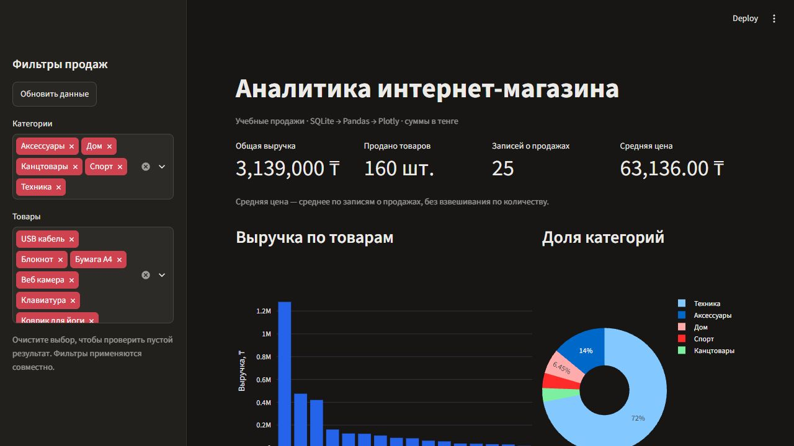
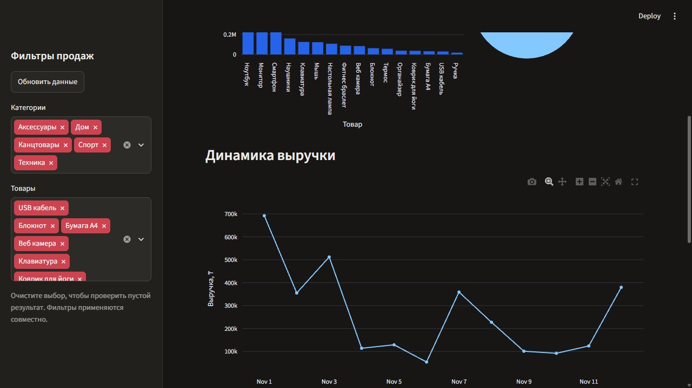
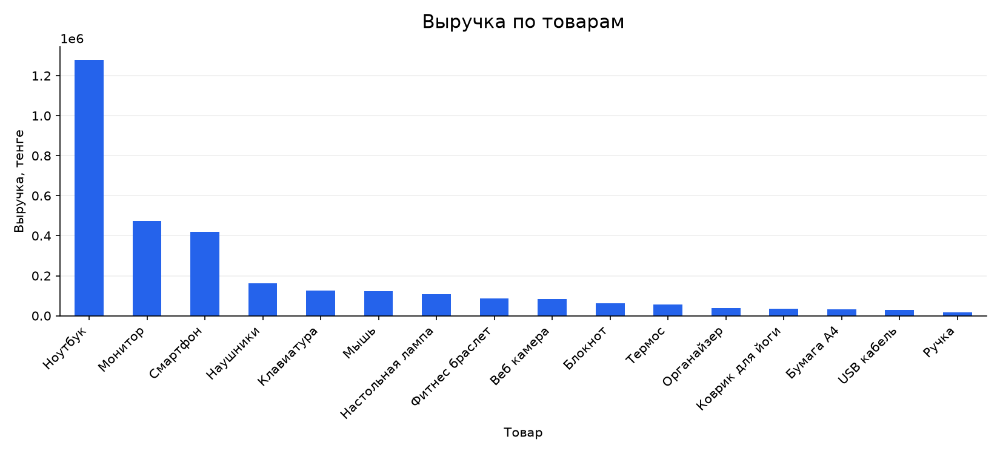
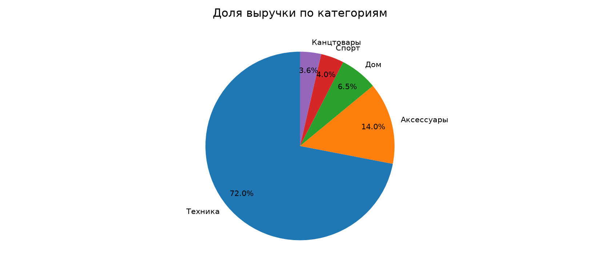
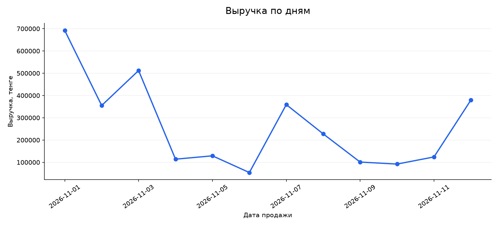

# Аналитика интернет-магазина

Учебный проект для пяти дней практики BilimX. GitHub: **shiin404**.
SQLite хранит продажи, Pandas рассчитывает показатели, Matplotlib сохраняет PNG, а Streamlit и Plotly показывают интерактивную панель.
Данные синтетические и не относятся к реальному магазину.

## Установка и запуск

Нужен Python 3.12 или новее. Выполняйте команды из папки проекта.

```bash
python -m venv .venv
# Windows PowerShell:
.venv\Scripts\Activate.ps1
# macOS/Linux: source .venv/bin/activate
python -m pip install -r requirements.txt
python setup_db.py
python add_day5_sales.py
python check_db.py
python analysis.py
python -m streamlit run dashboard.py
```

Откройте адрес, показанный Streamlit в терминале, обычно http://localhost:8501.
Готовая `shop.db` уже содержит 25 продаж. Повторный запуск `setup_db.py` и `add_day5_sales.py` не добавляет их ещё раз.
Пути к базе и графикам вычисляются относительно файлов Python, поэтому запуск из другой папки также поддерживается.
Если PowerShell блокирует активацию, используйте `.venv\Scripts\python.exe` вместо `python`; менять политику безопасности не нужно.

## Возможности

- Четыре показателя: выручка, проданные единицы, число записей и средняя цена.
- Совместные фильтры категорий и товаров; каждый показатель и график пересчитывается по отфильтрованным строкам.
- Три интерактивных графика: товары, категории и выручка по дням.
- Таблица выбранных продаж и экспорт CSV в UTF-8 с BOM.
- Пустой выбор даёт нулевые счётчики и сообщение, средняя цена отображается как «—».
- Кнопка обновления заново читает SQLite; кэш данных не используется.
- Пять сохранённых PNG и проверка качества данных без автоматического удаления совпадений.

## База данных и SQL

Таблица `sales`: `id`, `product`, `category`, `price`, `quantity`, `sale_date`.
Цена указана в целых тенге, количество — в штуках, дата — в формате YYYY-MM-DD.
Ограничения NOT NULL и CHECK исключают пустые названия, неположительные цены и количества.
Таблица `project_steps` отмечает применение начального набора и обновления дня 5.
Она предотвращает повторный посев, но не запрещает одинаковые реальные продажи.

Все запросы первого дня находятся в `check_db.py`: все строки; цена > 20 000; категория «Техника»; цена по убыванию; число строк; категории. Значения фильтров передаются параметрами.

## Результаты анализа

| Показатель | Значение |
|---|---:|
| Записей | 25 |
| Категорий | 5 |
| Проданных единиц | 160 |
| Общая выручка | 3 139 000 ₸ |
| Средняя цена записи | 63 136 ₸ |
| Медианная цена | 14 000 ₸ |

Топ-3 по выручке: ноутбук — 1 280 000 ₸, монитор — 475 000 ₸, смартфон — 420 000 ₸.
Техника приносит около 72% выручки. Максимум по дням — 692 000 ₸ 1 ноября; минимум — 54 000 ₸ 6 ноября 2026 года.
Лидерство техники в выручке объясняется в том числе высокой ценой; оно не означает лидерство по проданным единицам.

Пропусков, неположительных цен и количеств и совпадений без учёта ID в итоговом наборе нет.
Тестовая цена 15 000 000 ₸ повышает среднюю цену с 63 136 до 637 630,77 ₸, а медиану — с 14 000 до 16 000 ₸.
Перед опытом создаётся `shop_backup.db`. Единственная тестовая запись удаляется по её ID; транзакция откатывается, исходная таблица проверяется на равенство.
Подробные выводы: [день 2](day2_report.md), [день 3](day3_report.md).

## Обновление дня 5

В `add_day5_sales.py` добавлены ровно пять новых продаж и категория «Спорт».
Число записей выросло с 20 до 25, количество — со 132 до 160, выручка — с 2 635 500 до 3 139 000 ₸ (+503 500 ₸).
Изменения показателей при повторном запуске интерфейса проверены через Streamlit AppTest на отдельной тестовой базе.
Результат сохранён в `day5_update.json`.

## Скриншоты и графики











## Файлы по дням

| День | Результат |
|---|---|
| 1 | setup_db.py, check_db.py, shop.db |
| 2 | analysis.py, day2_report.md, charts/products.png, categories.png, quantities.png |
| 3 | day3_report.md, charts/daily.png, daily_quantity.png, shop_backup.db |
| 4 | dashboard.py, analytics_core.py, screenshots/ |
| 5 | add_day5_sales.py, day5_update.json, report/practice_report.docx |

`analysis_results.json` содержит расчёты последнего запуска. `defense_notes.md` — вопросы для самостоятельной подготовки к защите.

## Проверка

```bash
python test_project.py
```

Четыре теста проверяют повторный посев, SQL, добавление пяти продаж, фильтры, CSV и восстановление базы после выброса.
Интерфейс дополнительно проверен с помощью Streamlit AppTest и в браузере. Подробности — [verification.md](verification.md).
Самостоятельная защита и оценка преподавателя выполняются отдельно.
