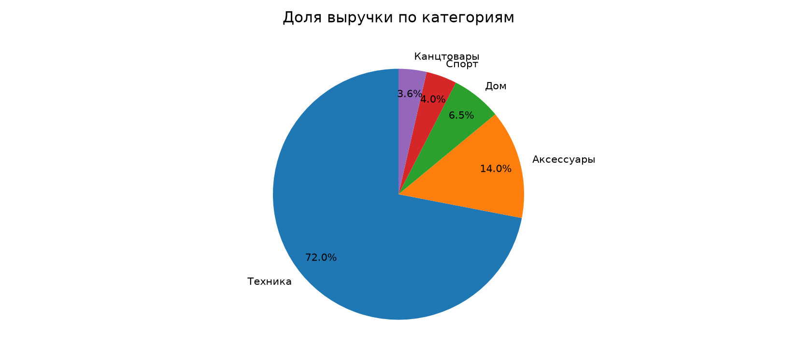
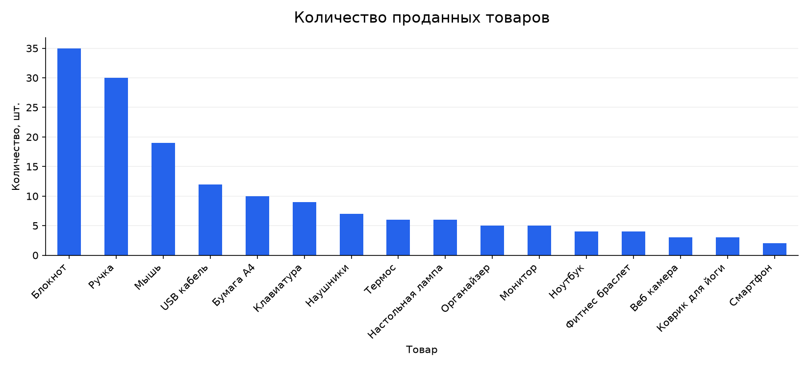

# День 2 Анализ продаж

Общая выручка составляет 3,139,000 тенге; продано 160 единиц в 25 записях.
Лидер по выручке — Ноутбук: 1,280,000 тенге.
Категория Техника приносит 72.0% всей выручки.

Топ 3 по выручке:
- Ноутбук: 1,280,000 тенге
- Монитор: 475,000 тенге
- Смартфон: 420,000 тенге

