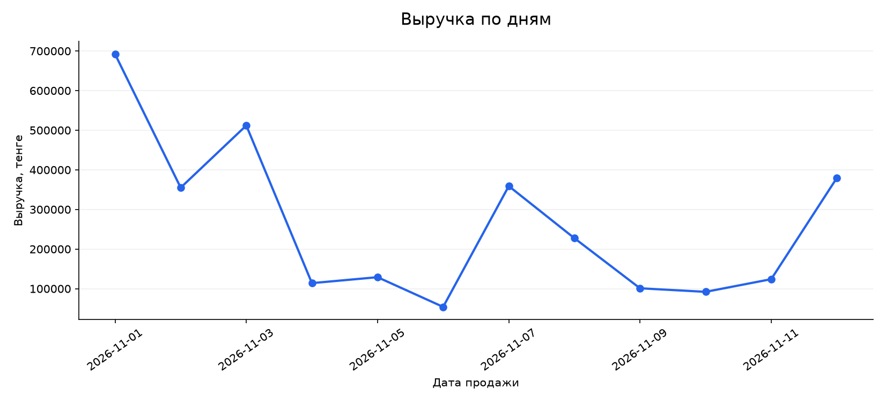
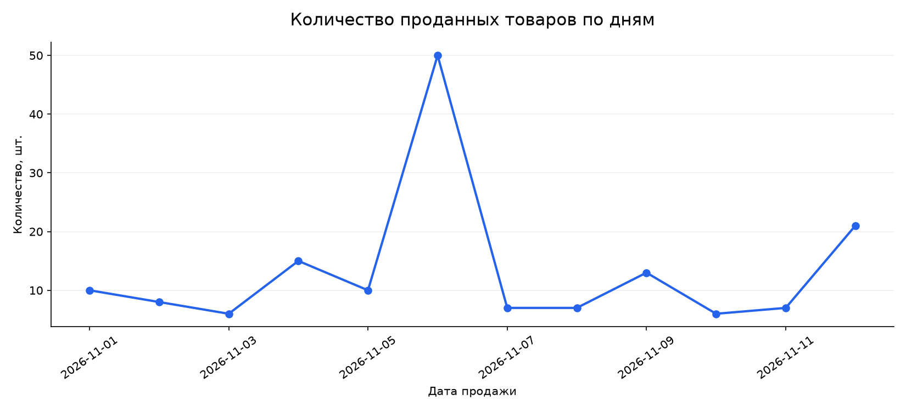

# День 3 Проверка качества и исследование продаж

Источник — shop.db. Данные синтетические, предназначены для практики.

## Качество данных

```json
{
  "missing": {
    "id": 0,
    "product": 0,
    "category": 0,
    "price": 0,
    "quantity": 0,
    "sale_date": 0,
    "revenue": 0
  },
  "duplicates_without_id": 0,
  "invalid_prices": 0,
  "invalid_quantities": 0
}
```

Совпадения проверяются по полям продажи без ID. Автоматическое удаление совпадений не применяется. Даты проверяются при загрузке.

## Эксперимент с выбросом

Перед вставкой создана shop_backup.db через SQLite backup API. В транзакцию добавлена ровно одна тестовая продажа; после расчёта удалена по её ID. rollback гарантирует полное восстановление, включая счётчик ID. Равенство таблицы до и после проверено.

## Аналитические выводы

1. Общая выручка составляет 3,139,000 тенге; продано 160 единиц в 25 записях.
2. Лидер по выручке — Ноутбук: 1,280,000 тенге.
3. Категория Техника приносит 72.0% всей выручки.
4. Максимальная дневная выручка 692,000 тенге получена 2026-11-01.
5. Минимальная дневная выручка 54,000 тенге получена 2026-11-06.
6. Средняя цена 63,136.00 тенге выше медианы 14,000.00; дорогая техника смещает среднее вверх.
7. Тестовая цена 15 000 000 тенге повышает среднее с 63,136.00 до 637,630.77, медиану — с 14,000.00 до 16,000.00 тенге.
8. Выводы описывают учебные данные за наблюдаемые даты; они не доказывают сезонность или причины изменения спроса.




